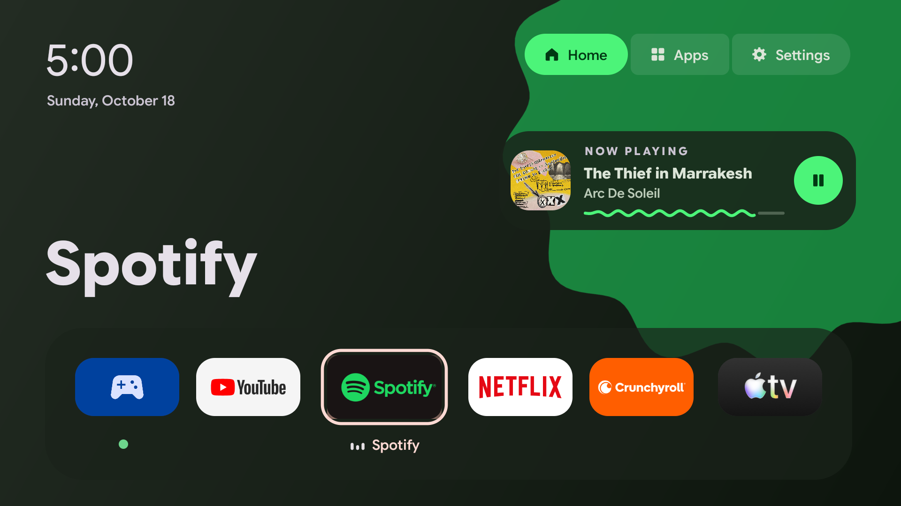
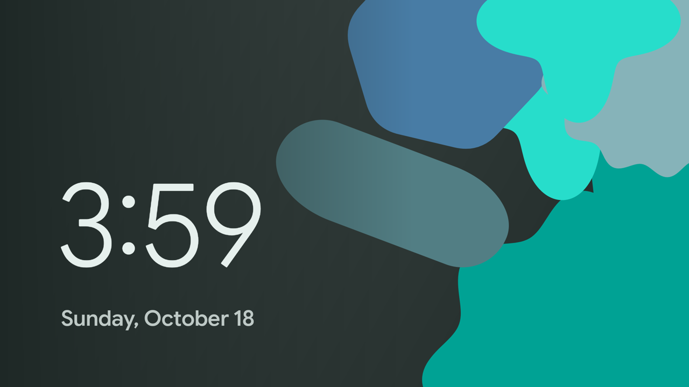

# Material TV Launcher

**A buttery smooth launcher for Android TV and Google TV.**

Your most-used apps, in the order you use them, in colors that follow the app you're on.
No ads, no recommendations, no internet permission, about 40 MB of memory.

## What you get

- **Your apps, by use.** The dock shows the six apps you use most, most used on the left. It reorders itself
  as your habits change. No app list is hardcoded, so it works on anyone's TV.
- **Colors from the app you're on.** As you move, the background, the shape, the buttons and the Now Playing
  card re-tint to the focused app, using Google's own
  [material-color-utilities](https://github.com/material-foundation/material-color-utilities) (the same math
  behind Android's wallpaper colors).
- **Your consoles, by name.** Instead of a generic "Live TV" tile, devices that announce themselves over HDMI
  (a PlayStation 5, an Xbox) get their own tile, with a green dot while they're on. Select it and the TV switches
  straight to that input.
- **Now Playing.** When music or video plays in any app (Spotify, YouTube Music, ...), a card shows the art,
  the song, a wavy progress line and a play/pause button, and a little equalizer marks the playing app in the dock.
- **Material 3 Expressive.** Spring motion, a colored focus glow, shapes from the Material shape library that
  morph as you move, a top-bar strip, neighbors that make room, a morphing loader when an app is slow,
  and a Google Sans Flex clock whose weight follows the time of day.
- **Buttery smooth.** Animations run on every display frame: zero janky frames at 60 Hz (`dumpsys gfxinfo`) on a
  budget quad-core TV chip. It uses about 40 MB of memory, and nothing animates or polls while you're in another
  app.

**And a screensaver that follows the sun.** *Material TV Clock* draws a fresh Material You-style wallpaper
every hour: indigo at night, peach at sunrise, sky blue at midday, orange at sunset.

## Set as default launcher

Google TV ignores any home screen that isn't its own, so a launcher needs a little help:

1. **Install** one APK from your computer over Wi-Fi, using the TV's debug bridge (ADB).
2. **Switch on** three things with one script: a tiny accessibility service that sends the remote's Home button
   here, usage access to order your apps, and notification access so the Now Playing card can see which app is playing.
3. **Press Home.** That's it. Nothing on the TV is removed, and one command puts everything back.

Follow the [Quick start](AGENTS.md#quick-start) yourself or [install with your coding agent](AGENTS.md#install-with-a-coding-agent).

## Supported TVs

Any TV running Android TV or Google TV on **Android 12 or newer**, from any brand. Tested on Google TV. Untested:
classic Android TV (the Home button should work the same way) and Amazon Fire TV (Fire OS, which is based on
Android). Not supported: Samsung (Tizen) and LG (webOS).

Tried it on your TV? A short report with a screenshot helps others, see [Contributing](#contributing).

## Privacy

The app has **no internet permission**, so nothing it reads can leave the TV.

See [permissions and verification](AGENTS.md#privacy).

## Contributing

The most useful thing you can send is a tested-TV report with a screenshot. Launcher ideas that keep it light
are welcome too: see [CONTRIBUTING.md](CONTRIBUTING.md).

[Build instructions](AGENTS.md#build-it-yourself) and [troubleshooting](AGENTS.md#troubleshooting) are in AGENTS.md.

## License

Apache 2.0, see [`LICENSE`](LICENSE). Bundled:
[material-color-utilities](https://github.com/material-foundation/material-color-utilities) (Apache 2.0) and
[Google Sans Flex](https://github.com/googlefonts/googlesans-flex) (SIL Open Font License 1.1). "Google",
"Google Sans" and "Material Design" belong to Google; this project is not affiliated with or endorsed by Google.
